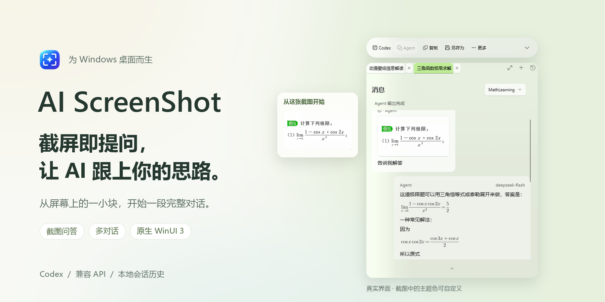
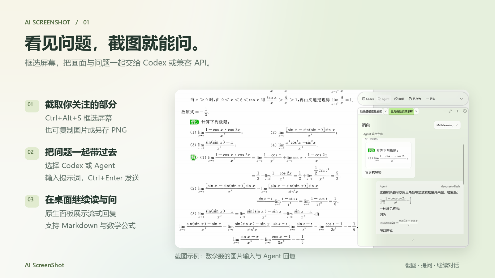
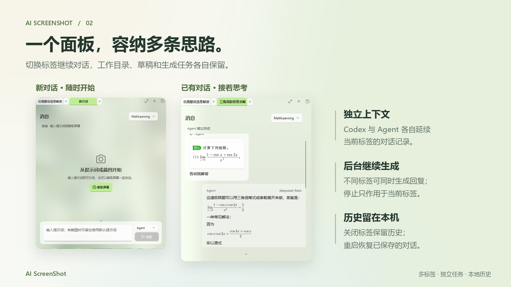
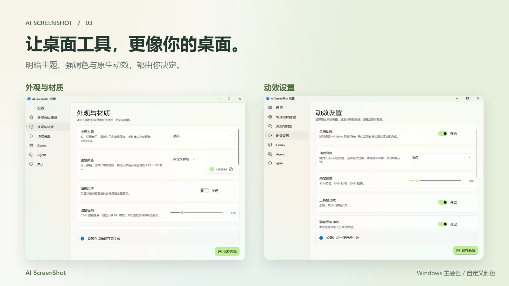
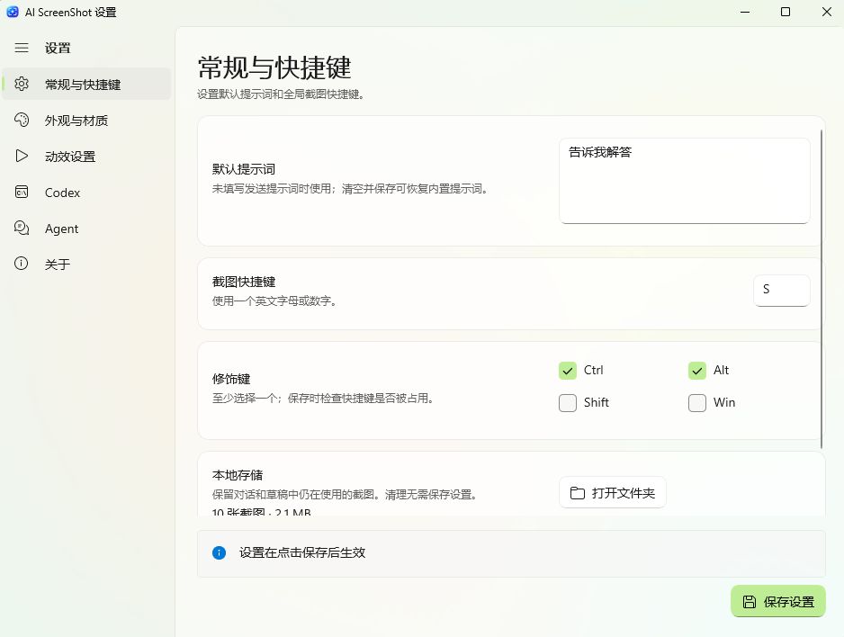
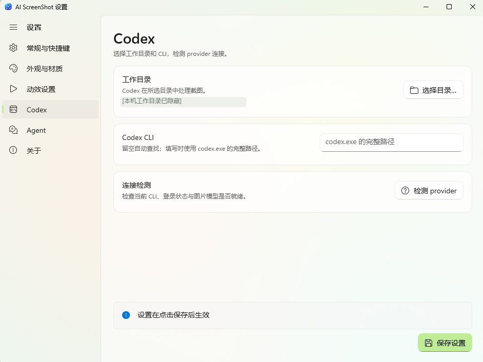
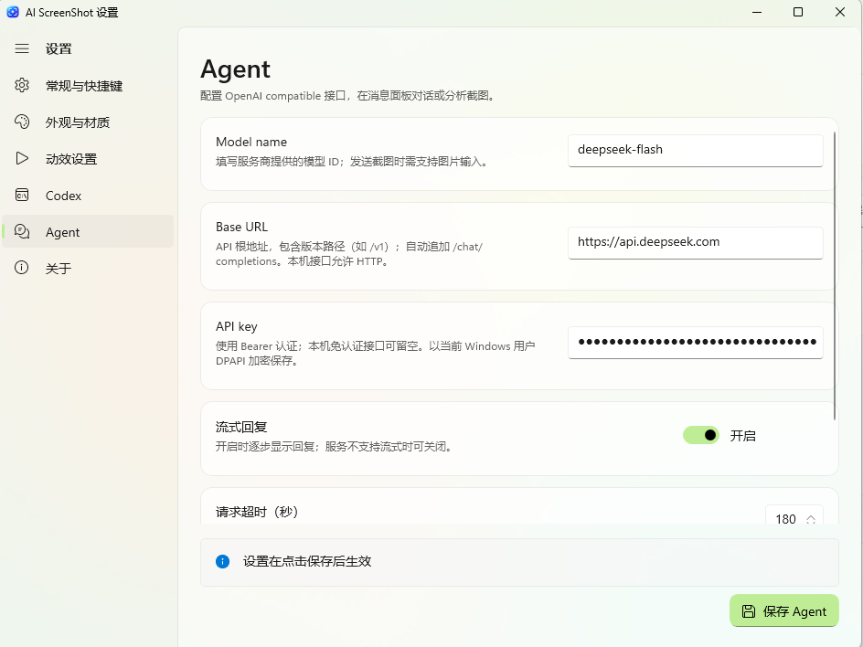

<div align="center">

<h1>AI ScreenShot</h1>
<p><strong>截屏即提问，让 AI 跟上你的思路。</strong></p>
<p>Windows 原生截图与 AI 对话工具</p>

<p>
  
  
  
  
</p>

<p>
  <a href="#下载与安装">下载与安装</a> ·
  <a href="#核心功能">核心功能</a> ·
  <a href="#快速上手">快速上手</a> ·
  <a href="#从源码构建">从源码构建</a>
</p>

</div>



AI ScreenShot 把**矩形截图、提示词和 AI 回复**放在同一段桌面工作流中。截取一道题、一条错误提示或一块你想弄懂的界面，选择 Codex 或兼容 API，在原生悬浮面板里阅读回复、继续追问。

不需要截图时，也可以直接开始文字对话。多标签保留各自的工作目录、草稿与上下文，本地历史让你下次打开时接着思考。

> 当前为开发中的 Windows 11 x64 项目。功能已进入代码，但真实模型兼容性、混合 DPI 多屏和部分系统外观仍需实机验收，详见 [项目状态](PROJECT_STATUS.md)。

## 下载与安装

从 [GitHub Releases](https://github.com/cricket152/AI_ScreenShot/releases) 获取 Windows x64 自包含便携包：

- [下载 2026.10.11 Preview ZIP](https://github.com/cricket152/AI_ScreenShot/releases/download/v2026.10.11-preview/AIScreenShot-win-x64-20261011.zip)
- [下载对应 SHA256 校验文件](https://github.com/cricket152/AI_ScreenShot/releases/download/v2026.10.11-preview/AIScreenShot-win-x64-20261011.zip.sha256)

当前发布为 **Preview**，尚未提供安装器。解压完整目录后即可运行；本次完整 UI 自测未通过的项目、未签名状态及验证范围见 [发布说明](docs/releases/2026-10-11.md)。

| 要求 | 说明 |
| --- | --- |
| 系统 | Windows 11 22H2（build 22621）或更高版本 |
| 架构 | x64；当前没有 ARM64 原生发布目标 |
| 应用运行时 | 发布脚本生成的便携包自包含 .NET 与 Windows App SDK；使用者无需安装 SDK |
| AI 服务 | Codex 和 Agent 二选一配置；图片分析需要所选模型支持图片输入 |

拿到便携包后：

1. 将**完整目录**放到可读写的位置，运行 `ScreenShot.App.exe`，不要只复制 EXE。
2. 桌面右侧出现悬浮球；左键展开面板，右键打开设置。托盘也提供截图、设置和退出。
3. 完成下方任一种客户端配置，再按 `Ctrl+Alt+S` 开始截图。升级前先从托盘退出旧实例，避免旧版本继续响应快捷键。

### 首次配置

| 客户端 | 准备与配置 |
| --- | --- |
| **Codex** | 安装并登录 Codex CLI（需要时执行 `codex login`）；在消息面板或设置页选择真实工作目录。CLI 路径留空会自动查找，也可在设置中填写 `codex.exe` 完整路径，然后点击“检测 provider”。 |
| **Agent** | 在设置页填写 Model name、Base URL 和 API key，点击“保存 Agent”。接口需兼容 OpenAI Chat Completions；截图需图片输入能力。远程地址使用 HTTPS，本机免认证服务可留空 key 并使用 HTTP。 |

Codex 使用 CLI 的公开 App Server，**无需打开 Codex 桌面窗口**；工具沿用 CLI 的模型配置，检查失败时不会自动更换模型。Agent 的“检测连接”只检查认证与 `/models` 列表，图片能力需实际发送确认；服务不支持流式时可关闭“流式回复”。

**当前版本不需要浏览器扩展。** 官网发送、Native Messaging、Native Host 与注册脚本已移除；旧版安装的扩展不会由本工具自动卸载。完整配置说明见 [使用指南](docs/USER_GUIDE.md)。

## 核心功能

### 截图问答：把画面变成对话的起点

不用来回保存、上传和切换窗口。框选后输入问题，直接发送给 Codex 或 Agent，在同一个悬浮面板里查看流式回复。

- 静态矩形截图覆盖虚拟桌面；截图前隐藏自身悬浮窗口，支持复制图片与另存 PNG。
- 回复支持常用 Markdown 和 LaTeX 数学公式；可选择正文、复制回答原文、点击消息中的截图查看详情。
- 截图发送后输入新的提示词继续文字追问，追问不重复附带旧截图；也支持无图文字对话。



### 多对话工作空间：每条思路都有自己的位置

一道题、一个项目、一段临时讨论，可以分别放在不同标签里。切换时保留工作目录、发送模式、提示词草稿与截图，不打断其他标签正在生成的回复。

- `Ctrl+T` 新建，支持标签切换、拖动排序、手动重命名和历史重开；不同标签可同时生成回复。
- Codex 恢复本标签的原生会话；Agent 携带本标签内已完成的 Agent 历史，两个客户端与不同标签的上下文隔离。
- 关闭标签保留历史与后台任务，停止只针对当前标签；退出应用后未确认的发送不会自动重发。
- 最新截图可带入已有或新建标签，发送仍由用户触发；重启恢复已保存的标签、消息与草稿。



### 悬浮工具栏：常用动作留在手边

悬浮球可拖动、贴边和隐藏；工具栏与消息栏可移动、缩放、分别收起。紧凑工具栏保留 Codex、Agent 入口，展开后提供复制、另存为与更多操作。

阅读长回复时，进入当前显示器的全屏阅读，或折叠输入区留出空间；退出全屏后恢复原窗口尺寸与位置。

### 个性化设置：融入你自己的 Windows 桌面

这里的绿色只是一种截图示例。应用支持明、暗、系统主题，强调色可跟随 Windows，也可以用原生 ColorPicker 选择。

- 工具栏与消息栏分别调整 Acrylic、轻透 Acrylic 或透明色层，以及背景不透明度；边框、阴影和主题色混入比例可配置。
- 关闭、简约、丝滑、弹性、灵动五种动效预设，速度可调 50%–200%，工具栏、消息面板、标签与消息动效可分别开关。
- 全局截图快捷键、默认提示词和本地截图存储均有原生设置入口；外观与动效独立保存，关闭设置撤销未保存的预览。



## 软件界面

下面展示常规设置与两种客户端配置。点击图片可查看原尺寸；Codex 的本机目录已脱敏，Agent 的 API key 在原截图中已由 PasswordBox 隐藏。

| 常规与快捷键 | Codex 配置 |
| --- | --- |
|  |  |

<details>
<summary>查看 Agent 配置界面</summary>



截图中的服务地址和模型是当时的配置示例，不代表推荐、绑定服务或已验证所有模型支持图片。

</details>

## 快速上手

1. **启动并展开。** 运行便携包里的 `ScreenShot.App.exe`，点击悬浮球展开工具栏和消息面板。
2. **截取屏幕。** 按默认 `Ctrl+Alt+S`，拖动框选要分析的区域；`Esc` 或遮罩上右键取消。
3. **选择客户端。** 输入区选择 Codex 或 Agent；Codex 还需在消息标题栏选择工作目录。首次使用先完成[客户端配置](#首次配置)。
4. **写下问题。** 输入提示词，点击“发送”或按 `Ctrl+Enter`；普通 `Enter` 换行。有截图而提示词为空时使用设置中的默认提示词，初始为“请描述并分析这张截图”。
5. **查看并继续。** 回复会在当前标签中更新。输入不同的新提示词继续追问，或用 `Ctrl+T` 开始另一个对话。

| 操作 | 默认按键或入口 |
| --- | --- |
| 截图 | 全局 `Ctrl+Alt+S`；可在设置中修改 |
| 发送 / 换行 | 输入区 `Ctrl+Enter` / `Enter` |
| 新建对话 | 面板内 `Ctrl+T` 或标签栏“＋” |
| 全屏阅读 | 标签栏全屏图标；全屏内 `Esc` 恢复 |
| 取消或收起 | 遮罩内 `Esc` 取消截图；普通面板内 `Esc` 收起 |
| 找回隐藏的悬浮球 | 托盘菜单“显示悬浮球” |

## 数据存储与隐私

设置、对话和截图保存在当前 Windows 用户的 `%LOCALAPPDATA%\AIScreenShot`：

| 内容 | 保存方式 |
| --- | --- |
| 设置 | `settings.json`，普通配置为明文 |
| Agent API key | 当前用户 Windows DPAPI 加密后的密文，不能视为整个配置文件加密 |
| 对话与草稿 | `conversations.db`，本地 SQLite 数据库 |
| 截图 | `screenshots/` 下的 PNG；消息和草稿引用的图片会保留 |
| 运行诊断 | `diagnostics/`；截图、提示词、回复和 key 不写入内容日志 |

发送时，截图与提示词会交给所选服务；后续 Agent 请求还会携带本标签内已完成的 Agent 历史与历史截图。Codex 按正常会话保存内容，远端保留策略由服务方决定。本地对话和 PNG **并未加密**。

Codex 使用公开 App Server 接口，不访问 Codex 内部数据库；截图分析会话使用只读 sandbox，不自动批准扩大权限的请求。发送结果不明确时显示 `Unknown`，保留已收到的正文，禁止自动重发。

设置中的“本地存储”可统计占用、打开文件夹，并在确认后清理未被任何消息或草稿引用的截图；不能用它删除全部历史图片。删除本应用对话不会删除 Codex 自身的历史或服务端记录。详见 [使用指南](docs/USER_GUIDE.md#对话标签与本地记忆)。

## 常见问题

**不配置 AI 也能截图吗？**

可以使用框选、复制和 PNG 保存；AI 问答需要配置 Codex 或 Agent。

**为什么 Agent 能检测连接，却不能分析图片？**

检测不验证图片能力。请确认服务和模型接受图片输入；截图中的模型名称只是配置示例。

**发送结果未知时怎么办？**

先检查客户端或服务端是否已经接收。程序不会自动重发同一请求；Codex 恢复时会尝试通过公开接口核对。Agent 的“停止等待”只停止本地读取，不能保证服务端停止生成。

**支持录屏、滚动截图或 OCR 吗？**

当前只支持静态矩形截图，不包含录屏、滚动截图、OCR、标注、HDR 色彩还原或受保护内容捕获；没有长期记忆、RAG 或跨对话共享。

**数学公式都能显示吗？**

支持常用 LaTeX 数学子集，复制得到公式源文本。不支持完整 TeX 文档、宏包或 TikZ、PGFPlots、Mermaid 执行；未知语法或缺字会保留原文。Markdown 不执行 HTML、不加载远程图片。

## 技术栈

| 技术 | 用途 |
| --- | --- |
| C# / .NET 10 | 应用与核心策略 |
| WinUI 3 / Windows App SDK 2.5.1 | 原生控件、材质、主题与动效 |
| Win32 / GDI / Windows.Graphics.Imaging | 托盘、全局快捷键、屏幕捕获、选区绘制与 PNG 编码 |
| Codex CLI App Server | 公开 JSONL 协议、会话恢复、流式回复与生成中断 |
| OpenAI compatible Chat Completions | Agent 图片/文字对话、SSE 流式读取 |
| Windows SQLite / DPAPI | 本地会话索引与当前用户 API key 保护 |
| CSharpMath.Rendering | 数学语法解析及原生矢量排版 |
| FlaUI.UIA3 | 保留给旧 UI Automation 专项诊断；正常 Codex 发送使用 App Server |

浏览器扩展与 Native Messaging 不属于当前技术链路；UI 没有 WebView 或 Web UI 依赖。

## 从源码构建

需要 Windows 11 x64 与 .NET 10 SDK。仓库脚本优先使用 `.tools/dotnet/dotnet.exe`，没有时使用 PATH 中的 `dotnet`；首次构建会从 NuGet 还原依赖。

```powershell
# 构建 Release App，并运行控制台测试程序
powershell -ExecutionPolicy Bypass -File .\scripts\verify.ps1

# 生成完整的自包含便携目录
powershell -ExecutionPolicy Bypass -File .\scripts\publish.ps1 -OutputDirectory .\dist\AIScreenShot-win-x64

# 启动（升级前先从托盘退出旧实例）
.\dist\AIScreenShot-win-x64\ScreenShot.App.exe
```

发布目录含旧浏览器桥接文件时，脚本会拒绝混入旧功能；请改用新的输出目录。更多原生诊断和验证边界见 [开发指南](docs/DEVELOPMENT.md)。

```text
src/ScreenShot.App/      WinUI 3 应用、截图、悬浮界面与 Codex provider
src/ScreenShot.Core/     发送、配置、Markdown、会话及存储策略
tests/ScreenShot.Tests/  控制台断言与模拟协议测试
scripts/                验证、便携发布和宣传图生成脚本
docs/                   操作、开发、UI 设计与图片素材说明
licenses/               第三方依赖的许可证及 notices
```

## 协议、反馈与致谢

开发者：[cricket152](https://github.com/cricket152)。设置 → “关于”也提供可直接打开的 GitHub 主页链接。

**主项目许可尚未声明。** 当前仓库没有主项目 `LICENSE`，不应将它标为 MIT、GPL 或其他协议。`licenses/` 仅包含第三方依赖许可，不能代替本项目授权；具体依赖见 [THIRD_PARTY_NOTICES.md](THIRD_PARTY_NOTICES.md)。

欢迎在 [GitHub Issues](https://github.com/cricket152/AI_ScreenShot/issues) 提交问题或建议。请附上 Windows 版本、使用的客户端、重现步骤和异常状态；先检查截图与诊断文件，移除 key、账户和私人对话。

感谢 [DeskBox](https://github.com/Tianyu199509/DeskBox) 的 原生界面展示启发，以及 [ShareX](https://github.com/ShareX/ShareX) 的截图交互参考；未复制它们的源码、品牌图片或文案。宣传图由本仓库提供的真实截图原创合成，生成方法与素材来源见 [素材说明](docs/IMAGE_ASSETS.md)。
